浅浅记录下这次中秋国庆的北疆之行。

#### Day 1 预备

假期第一天，主要是在飞机上，飞乌鲁木齐。晚上和岳父的朋友吃饭，说来好笑，岳父的朋友说特意避开了大盘鸡、红柳串这些，说我们接下来可能会吃腻这些（后面发现也没有，很多时候赶路只能随便吃点），点了些奇奇怪怪的当地的东西（比如酸奶粽子），我只能说比较一般，我没吃爽（其实其他人也一样其实，笑死了）。

租的车是广汽传祺向往 M8，油电混动的 MPV。开着还行吧，摸索摸索各种功能也就过去了。开到酒店停车场还闹了个笑话，天黑没看清，以为两个停车位中间的人行道是停车位（自动泊车系统显然也认同），结果停到了人行道上，笑死我了。下车才发现不对，赶紧换个地方。

#### Day 2 沙漠公路与海上魔鬼城

第二天，驱车离开乌鲁木齐市区，穿越古尔班通古特沙漠。主要走 S21 沙漠公路，赶路为主。名字虽是沙漠公路，也不是刻板印象中那种沙漠，更像是一种混合体。一路发现除了路途沿线的高速休息区车都比较多，毕竟不少人请 3 休 13 吧，也没办法。图为在休息区羊肉烧烤摊旁边发现的一只靓羊：

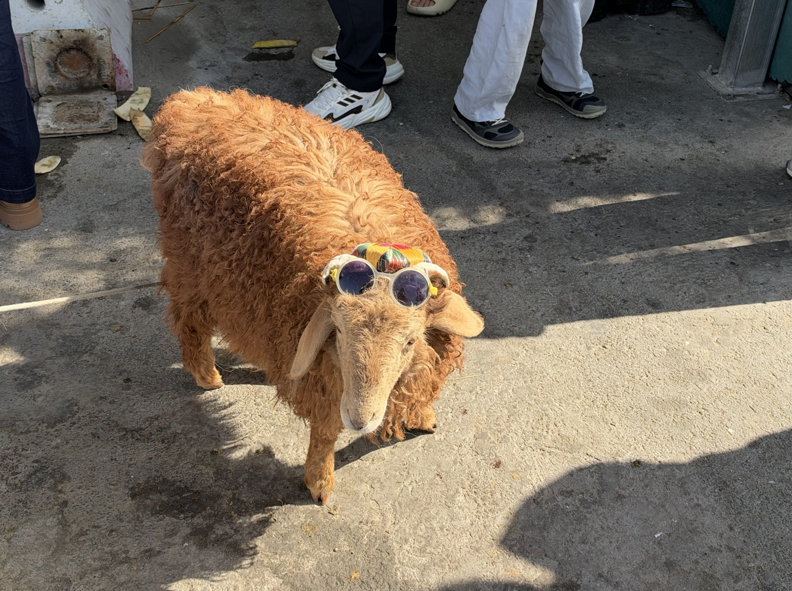

一路开到福海县城，发现停车还挺麻烦，一路路面都停满了。最后找到个酒店门口的停车位，但偶遇不错的大盘鸡，也是才知道大盘鸡的大真的是形容词，因为有中盘鸡。

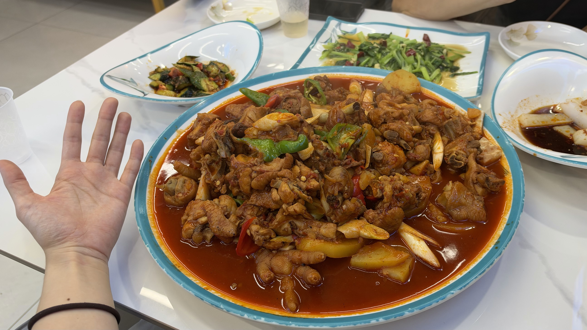

吃饱喝足，发现不想开夜路的话时间不太够了，就海上魔鬼城和乌伦古湖边二选一，选了海上魔鬼城。

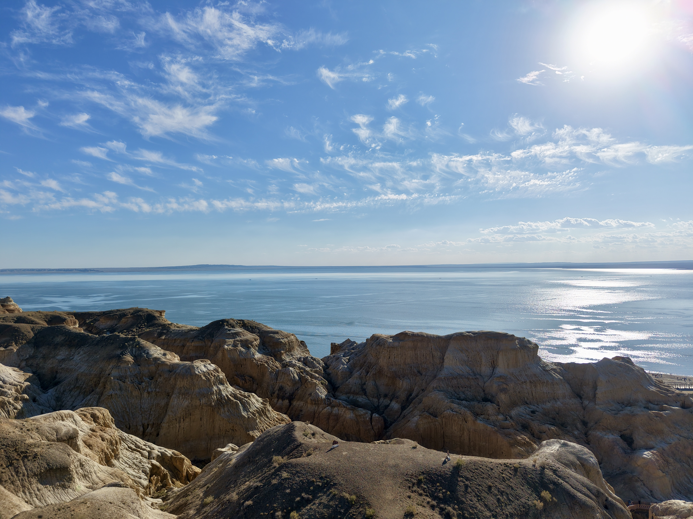

然后驱车到阿勒泰市中心的全季酒店，没停车位，被保安赶出来后想着先去餐厅吃饭。好巧不巧找的烧烤店也是网红店，也没有停车位，还要等 100 多桌。找了半天车位，好不容易下车，放弃烧烤，随便走了走路边吃了个拉面就先去 check in 了，还好那时候酒店停车位有空位了。也确实大车确实停车稍微麻烦些。

#### Day 3 阿禾公路 

第三天，离开阿勒泰市区，正式开始阿禾公路的行程。

堵车，非常堵车，还没出城就开始堵车，前 30% 的行程都很堵，这对人的膀胱是个考验。一路上的厕所都是那种移动便携的，并且基本都要排队。本来因为堵车非常烦躁，一上阿禾公路就觉得，风景绝好，还是该走这条路而不是走 217 国道转 232 省道那条。没去之前以为是正常的盘山公路，应该有地方可以随时停下来看风景，去了发现车道很窄，也只有观景台可以合法停车，但好的观景台一般有很多人，停车位紧张。

  
  

行至中途发现有一段是光秃秃的山，不是很好看，本以为就这样了，但往后走又是层林浸染的景观。所以回头看当天的体验曲线其实很好，一开始大堵车直接让心情到低谷，然后见到风景又开始上升，接着风景又变秃了，然后再是大片的金黄秋色与树海景观。

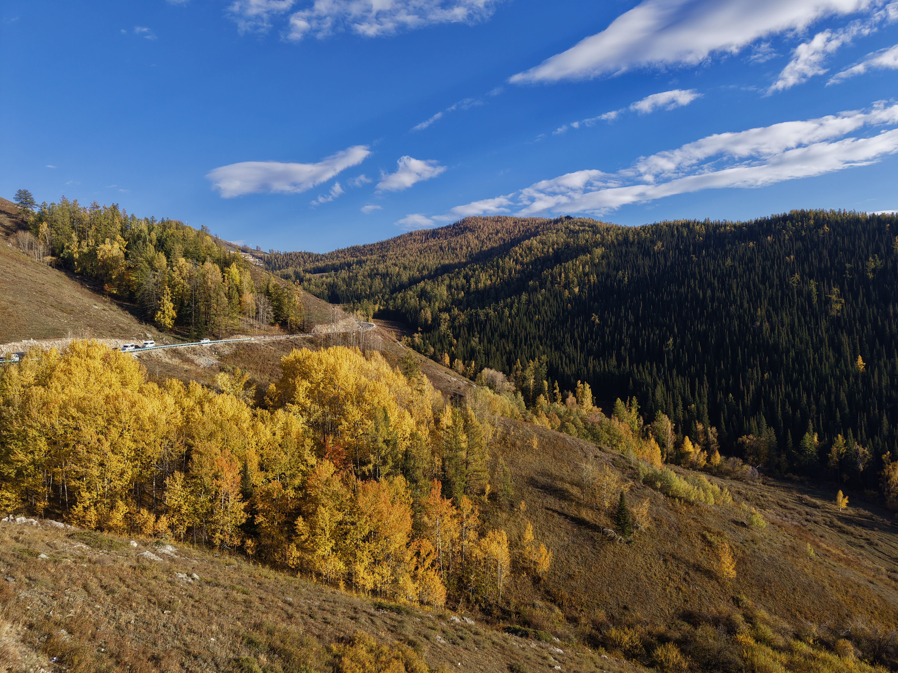

堵车太多发现来不及当日去禾木游玩了（本来计划是走阿禾公路到禾木游玩，然后再入住的），干脆放弃禾木，慢慢开，直接晚上入住希尔顿。在行政酒廊随便吃点晚餐，好好休息。

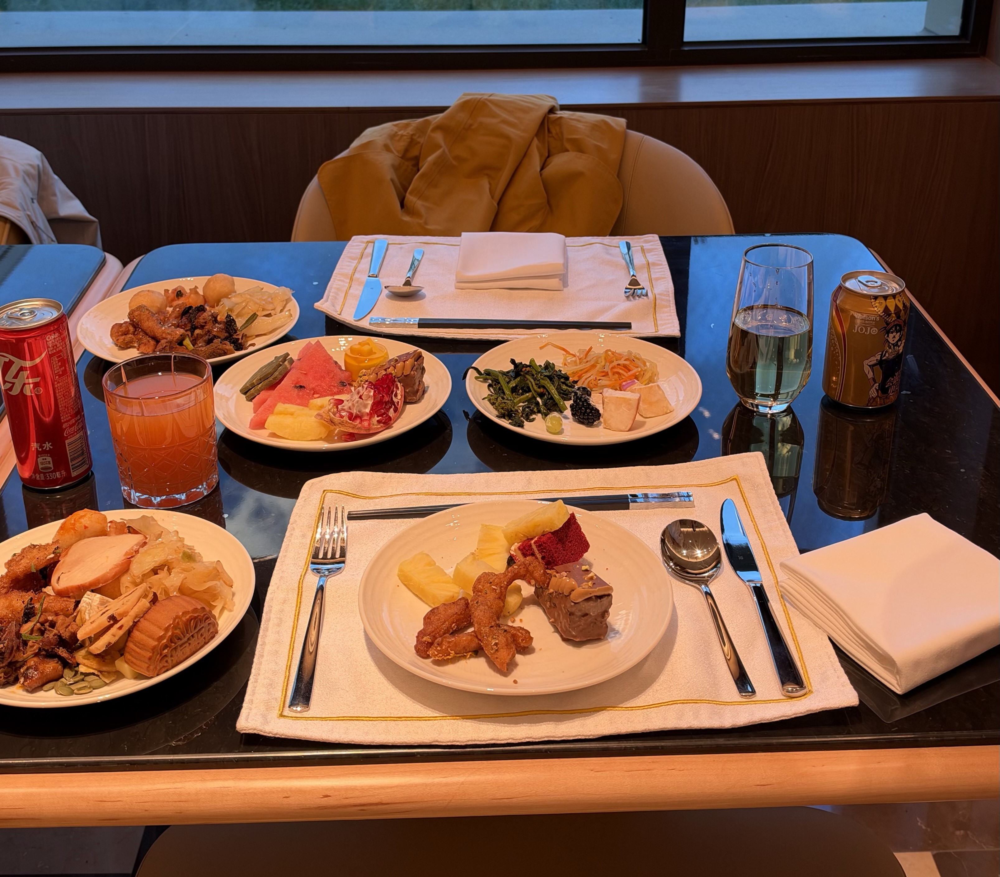

#### Day 4 禾木 

第四天，早起游玩禾木，主要是禾木桥附近走走，村子里转转，感受一下。游客说多不多，说少也不少，景区内还有不少奶茶店（这几天见得多的是蜜雪冰城、霸王茶姬与库迪咖啡）。禾木村：

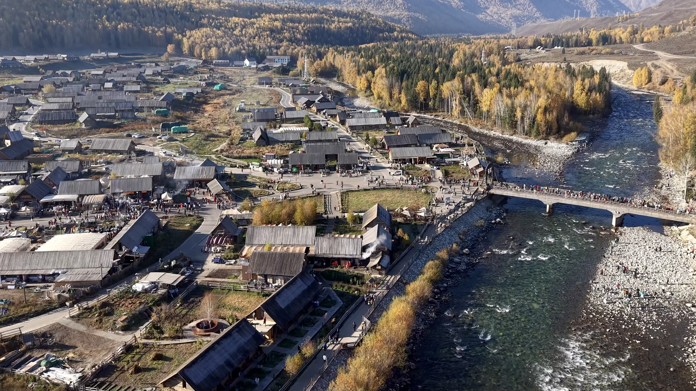

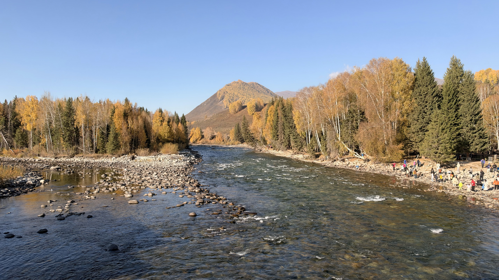

离开禾木出发贾登峪，出乎意料地 852 县道非常美，不输阿禾公路的景观，当然，进景区的路也是堵车。还被保安坑了一把，明明酒店有停车位，不让我们往里开，让我们在距离 2km 的公共停车场停车。最后还是我们打电话给酒店确认有车位，不管三七二十一往里冲才进去的。感觉景区为了分流，真是脸都不要了。

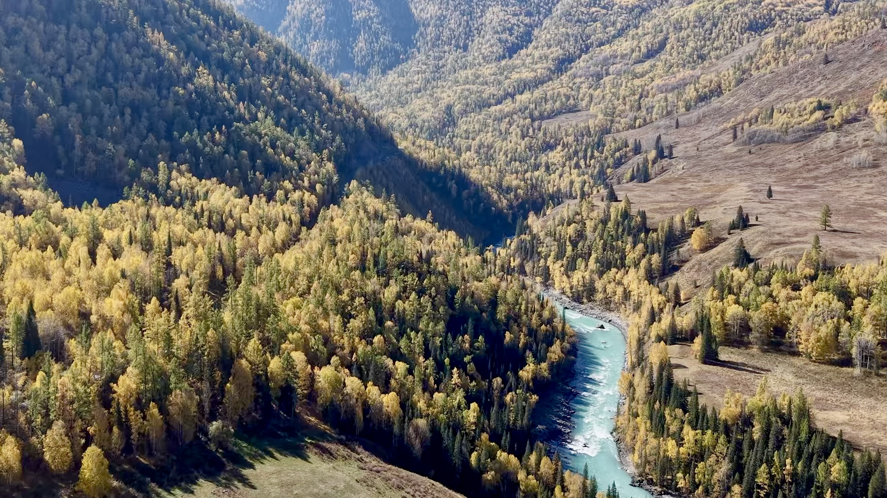

堵车导致我们到贾登峪入住之后已经差不多是晚上了，为了不浪费两日的喀纳斯门票，还是决定进去速玩。我们酒店特意选在了贾登峪游客中心门口，所以停好车步行前往即可。进去坐车 40 分钟到达月亮湾之后逛了逛，就踏上返程坐车出景区。没有很好的光线，所以景致也是一般。出来到贾登峪游客中心已经 8 点 30 多了，随便找了个店吃晚餐，基本没啥了，也是没吃好的一顿。

#### Day 5 喀纳斯

第五天，主菜，喀纳斯。做计划的时候果断放弃了观鱼台，白哈巴本就不在计划中，所以就是先去喀纳斯湖，然后三湾徒步。

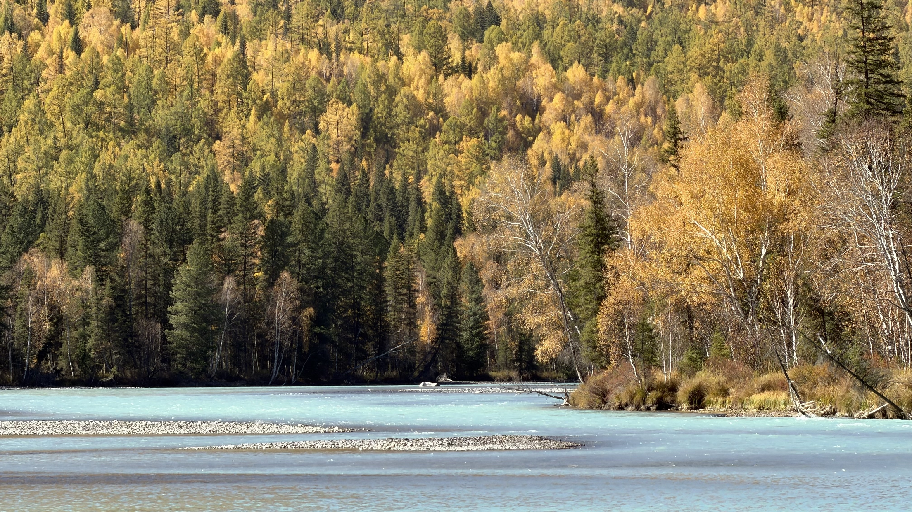

喀纳斯湖游船确实有点坑啊，不如往下游走走的景观好。很喜欢有翡翠色湖面的喀纳斯河。

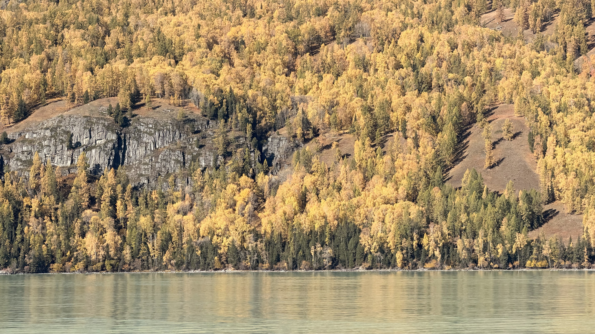

景区随便买了点可乐、烤肠，结合昨晚买的一些零食当午餐了。

然后还是回到了三湾那边，转了转神仙湾（当日就算早起也没有晨雾，可惜），然后坐车到月亮湾，开始沿着河谷栈道徒步到卧龙湾。择地求婚，成功，晚上吃到了昨天人满为患的火锅来庆功，舒适。

  
  

#### Day 6 世界魔鬼城

第六天，离开喀纳斯。从今天开始就不存在啥堵车情况了，也是开车为主。路上随机停车在外面转了转白沙山的沙漠，景区只开放了越野车项目，想想也是很离谱。也是可惜，这趟行程没有机会去白沙湖。

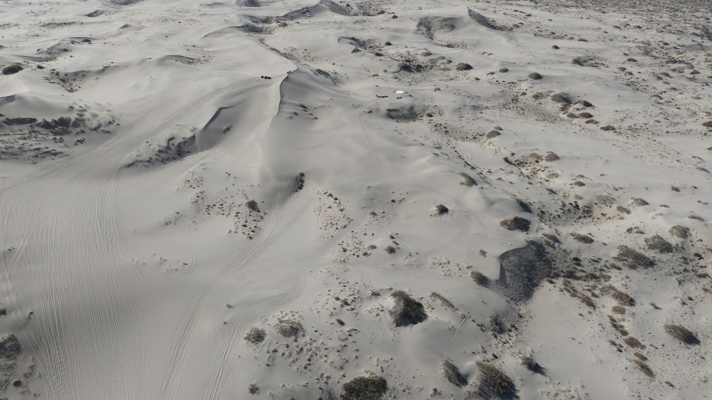

中午到了布尔津县城内，偶遇一家非常不错的冰煮羊肉，让我想到了以前在阿尔山吃过的惊为天人的冰煮羊肉，丈母娘和岳父也是赞不绝口。然后直接开车到世界魔鬼城，比海上魔鬼城更加纯粹与震撼的体验。

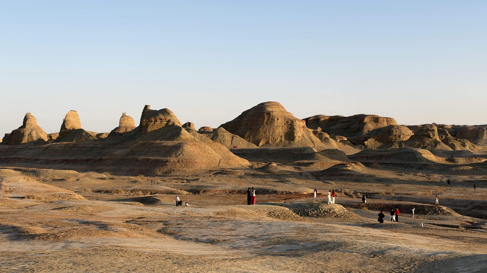

晚上入住酒店之后在乌尔禾度假区随便找了家店吃晚餐（其实算是夜宵了），点了很多菜都告诉我没了，兜兜转转一共加菜四次，主要是吃烧烤、缸子肉、过油拌面，这过油拌面出乎意料地好吃！

#### Day 7 胡杨林

第七天，离开克拉玛依。离开之前逛了逛乌尔禾度假区附近的胡杨林，小红书说是免费的，驱车前往发现人车都要收费，本着来都来了的心态还是开车进去看了看，确实挺美。

  
  

此后一路驱车回到乌鲁木齐，晚上吃了一家叫楼兰密语的火锅，就正常水平吧。

我因为得了流感晚上以休息为主，对象及其父母去了大巴扎，带回了一个巨大的馕，而且出乎意料地好吃。

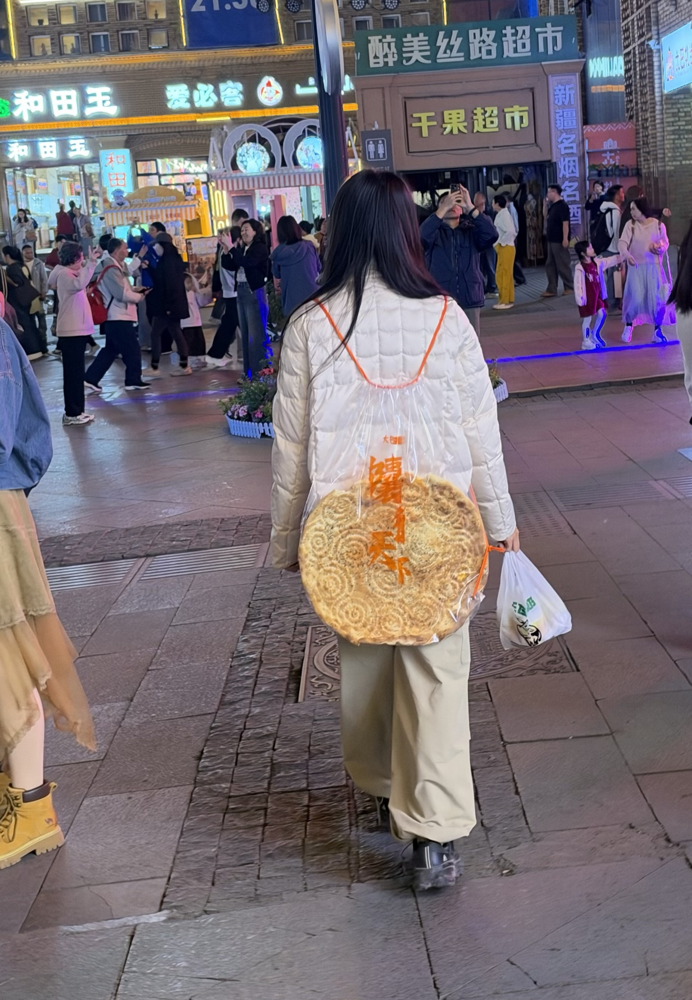

#### 后记

然后就是飞离乌鲁木齐（流感之后坐飞机耳朵是真的要爆炸一样），在上海开启两天的怀旧模式，回忆当时在上海的恋爱点滴——吃肥汁米兰、逛五角场 muji、niko and 等等，还约了一霏、王吉和 Tracy 出来叙旧，真棒。

